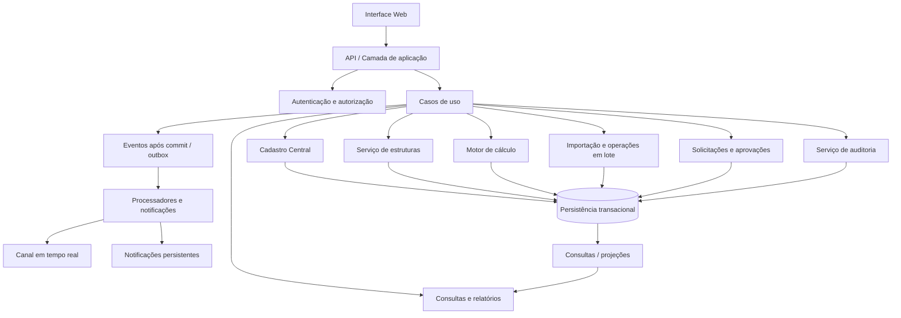

# Arquitetura técnica consolidada — Alianza Sistema de Custos

**Status:** proposta de arquitetura de referência para revisão.  
**Não significa:** stack aprovada, implementação concluída, autorização de infraestrutura, migration ou deploy.  
**Precedência:** regras funcionais aprovadas e Registro Mestre prevalecem sobre este desenho quando houver conflito.

## 1. Objetivo e princípios

O Alianza é um sistema de cadastro central e apuração de custo industrial. Não é CRM, estoque, sistema fiscal, compras ou formação de preço de venda.

Princípios arquiteturais:
1. Backend é a autoridade para regras, permissões, cálculos e persistência.
2. Cadastro Central é a identidade única dos itens; estruturas referenciam itens, não os duplicam.
3. Regras de domínio ficam independentes da interface e dos mecanismos de transporte.
4. Toda operação de impacto é autorizada e validada no servidor.
5. Mudanças de dados e seus eventos de auditoria são persistidos de forma consistente.
6. Atualizações em tempo real avisam sobre mudanças; não substituem banco nem API.
7. Histórico de custos, auditoria, notificações e registros operacionais têm finalidades distintas.
8. A arquitetura deve ser testável sem depender da interface gráfica.

## 2. Visão lógica

O desenho é lógico, não impõe microserviços. A recomendação inicial é separar módulos e responsabilidades dentro de uma aplicação backend coesa, evitando distribuição prematura. A divisão física só deve ocorrer se escala, isolamento ou operação justificarem.

## 3. Módulos e responsabilidades

### 3.1 Identidade, autenticação e autorização
- Login individual e segundo fator conforme regras aprovadas.
- Papéis Administrador, Editor e Visualizador.
- Avaliação no backend por usuário, ação, recurso, estado e contexto.
- Editor pode cadastrar item novo e propor alterações limitadas à descrição principal/complementar; aprovação do Administrador formaliza a mudança.
- Operações de impacto permanecem exclusivas do Administrador conforme Registro Mestre.
- RLS é uma camada adicional de proteção no banco, não substitui a autorização na aplicação.
- Mudança de papel/permissão invalida caches e sessões relevantes; não confiar em cache sem política explícita de invalidação.

### 3.2 Cadastro Central
Responsável por:
- identidade numérica exclusiva;
- descrição principal e complementar;
- família única obrigatória;
- unidade única por item;
- tipo Simples ou Composto;
- situação ativo/inativo;
- custo manual de Simples ou custo derivado de Composto;
- pesquisa, filtros e consulta.

O cadastro não deve conter regra de interface como autoridade. IDs reservados, inativos ou excluídos logicamente não podem ser reutilizados conforme regra aprovada. Divergência sobre geração/atribuição de ID está listada na seção 11.

### 3.3 Serviço de estruturas
- Mantém relações pai-componente e quantidades.
- Referencia itens do Cadastro Central.
- Permite níveis multinível e componentes repetidos.
- Impede autorreferência e ciclos indiretos.
- Revalida itens ativos e compatibilidade de unidade/regras de estrutura.
- Calcula dependências afetadas e ordenação bottom-up.
- Produz fotografia/versionamento necessário à consulta histórica, sem assumir ainda a estratégia final de versionamento.

### 3.4 Motor de cálculo
- Recebe estrutura validada e custos vigentes dos componentes.
- Calcula custo de cada composto a partir das ocorrências de componentes.
- Não aceita custo manual para item composto.
- Não converte unidades, não reaplica desperdício e não incorpora MOD/GGF, tributos ou margem comercial.
- Mantém precisão interna definida por decisão técnica posterior e aplica regra de apresentação aprovada.
- Expõe cálculo determinístico e testável, sem depender de UI, sessão ou estado transitório.
- Não deve misturar leitura de dados, regra de domínio e efeitos de notificação no mesmo método.

### 3.5 Orquestrador de recálculo
- Identifica compostos dependentes direta e indiretamente.
- Constrói grafo de dependências, valida ciclos e calcula ordem.
- Agrupa a cascata sob um identificador de operação/correlação.
- Persiste custos vigentes, histórico e auditoria de maneira consistente.
- Se a cascata for grande, pode ser executada em tarefa; isso depende de medição e não está decidido.
- Não expõe custos parcialmente atualizados como se a cascata estivesse concluída.

### 3.6 Solicitações e aprovações
- Registra proposta, autor, campo, valor atual/proposto, datas, estado e justificativas.
- Controla titularidade de análise e decisões concorrentes atomicamente.
- Aprovação revalida permissões, valores e referências antes de aplicar.
- Rejeição não altera o cadastro.
- Timeline e eventos de transferência, lembretes, encerramento e decisão permanecem auditáveis.
- O fluxo de aprovação não pode ser contornado por API, importação ou operação em lote.

### 3.7 Importação e operações em lote
- Sessão de importação, arquivo/referência, mapeamento, prévia, validações, erros por linha, aprovação e resultado.
- Prévia não altera cadastro oficial.
- Na confirmação, revalidar permissão, versão/estado dos registros e referências.
- Aplicar somente linhas válidas aprovadas, respeitando decisão funcional de sucesso parcial por linha.
- Cada linha ou grupo de linhas interdependentes deve ter transação definida; uma cascata disparada por uma linha deve manter sua integridade.
- Auditoria de domínio de cada alteração efetiva; registro operacional do lote separado.
- Reenvio/retry deve ser idempotente e não duplicar registros, custos, notificações ou histórico.

### 3.8 Auditoria e histórico
Separar:
- histórico de custo;
- histórico/fotografia de estrutura;
- log de auditoria;
- registro operacional de importações/exportações/tarefas;
- timeline de solicitações;
- histórico de notificações e alertas.

Eventos auditáveis devem identificar ator, origem (UI/API/importação/tarefa), instante, ação, objeto, resultado, justificativa quando exigida e ID de correlação. Segredos não devem ser persistidos; quando inevitável, devem ser mascarados antes da gravação. Log não pode ser alterado/apagado pela UI.

### 3.9 Notificações e atualização em tempo real
- Persistir a mudança primeiro.
- Publicar evento depois do commit, idealmente por padrão outbox ou mecanismo equivalente confiável.
- Enviar payload mínimo: ID do objeto, versão/timestamp e tipo de evento.
- Cliente consulta API para obter estado atual e revalidar acesso.
- Após reconexão, reconciliar com backend; não presumir entrega de todos os eventos.
- Diferenciar evento transitório, notificação persistente, alerta crítico e auditoria.
- Canal (WebSocket/SSE/outro) permanece pendente.

### 3.10 Relatórios, painel e exportação
- Consultas não devem alterar domínio.
- Relatórios sob demanda, com filtros e paginação.
- Exportação respeita permissões e registra solicitação, responsável, resultado e acesso.
- Arquivos temporários são privados, com expiração e controle de acesso no backend.
- Limites e processamento assíncrono devem ser observáveis e configuráveis.

### 3.11 Tarefas e processamento em background
Usar apenas quando houver justificativa (tempo, volume, operação demorada ou desacoplamento):
- recálculos grandes;
- importações;
- exportações;
- alertas programados;
- verificações de integridade.

Cada tarefa deve ter ID, correlação, estado, tentativas, timeout, início/fim, erro classificado e resultado. Retry exige idempotência e limite; falha transitória não é falha final.

## 4. Fluxos críticos

### 4.1 Alteração de custo de item simples
1. Autenticar e autorizar.
2. Validar item, valor e versão atual.
3. Abrir transação.
4. Persistir novo custo e evento de histórico.
5. Determinar compostos dependentes e calcular cascata.
6. Persistir custos derivados e auditoria da operação.
7. Confirmar transação.
8. Publicar evento/notificações após commit.
9. Interface reconcilia dados e apresenta resultado.

Se o processamento for assíncrono, o sistema deve mostrar estado explícito de processamento e não anunciar conclusão antes do commit final. A estratégia de consistência visível durante uma cascata assíncrona ainda requer decisão técnica.

### 4.2 Alteração de estrutura
1. Autorizar operação.
2. Revalidar situação e identidade de todos os itens.
3. Detectar ciclos e referências inválidas.
4. Validar versão/concorrência.
5. Persistir alteração, fotografia/histórico e custos recalculados atomicamente dentro do limite transacional escolhido.
6. Auditar e publicar após commit.

### 4.3 Importação Excel
1. Criar sessão e registrar responsável.
2. Ler arquivo, mapear colunas e validar campos.
3. Exibir apenas alterações propostas e erros por linha.
4. Usuário confirma linhas válidas.
5. Backend revalida permissão, valores e versões.
6. Aplicar as linhas aprovadas com transações coerentes por linha/grupo dependente.
7. Auditar alterações efetivas e resultado do lote.
8. Publicar atualizações após commit.

### 4.4 Aprovação de solicitação
1. Administrador assume análise em operação atômica.
2. Backend impede titularidade simultânea.
3. Ao aprovar/rejeitar, revalidar estado, permissão e concorrência.
4. Aplicar mudança e registrar decisão/auditoria.
5. Notificar somente após persistência.
6. Transferência/encerramento exige os controles e justificativas definidos.

### 4.5 Exclusão lógica
1. Gerar prévia de impacto.
2. Confirmar explicitamente.
3. Revalidar dependências e versão, pois podem ter mudado.
4. Aplicar exclusão lógica e comportamento de vínculos definido nas regras.
5. Preservar fotografia histórica, auditoria e integridade.
6. Publicar resultado após commit.

## 5. Modelo de consistência

- Banco/backend são fonte da verdade.
- Operações que modificam mais de um objeto relacionado precisam de transação ou protocolo explícito de consistência.
- Não enviar notificações antes do commit.
- Não usar atualização em massa que ignore validações, eventos de domínio ou auditoria.
- Concorrência deve ser tratada por bloqueio, versionamento otimista ou combinação, escolhida conforme banco e perfil de carga.
- Bloqueios devem seguir ordem determinística para reduzir deadlocks.
- Conflitos são apresentados ao usuário; não há sobrescrita silenciosa.
- Operações repetidas precisam de chave de idempotência quando puderem criar efeitos duplicados.

## 6. Fronteiras de dados sugeridas

Entidades conceituais (não são schema/migration aprovado):
- Item;
- Família;
- Linha de Estrutura;
- Versão/Fotografia de Estrutura;
- Histórico de Custo;
- Operação de Recálculo;
- Solicitação de Alteração;
- Evento de Solicitação;
- Sessão de Importação;
- Linha de Importação;
- Evento de Auditoria;
- Notificação;
- Alerta;
- Exportação;
- Tarefa;
- Usuário/Papel/Permissão.

As chaves, cardinalidades, restrições e políticas RLS serão detalhadas somente após decisão de stack e modelagem de dados.

## 7. Estratégia de testes por camada

- Domínio: regras de cadastro, família, unidade, custo, estruturas, arredondamento e ciclos.
- Aplicação: fluxos completos e autorização.
- Persistência: transações, rollback, restrições e idempotência.
- Concorrência: duas conexões reais e disputas de edição/aprovação/recálculo/importação.
- Segurança: chamadas diretas à API, RLS, escalada de privilégio, enumeração, acesso cruzado e vazamento de segredos.
- Integração: eventos após commit, reconexão, filas, importação e exportação.
- Regressão: toda correção de incidente adiciona teste reproduzível.

## 8. Observabilidade e operação
- Logs estruturados com correlação, sem segredos.
- Métricas de duração de cálculo, tamanho de cascata, fila, retries, falhas, conflitos e latência.
- Painel de saúde reflete estado real dos serviços.
- Backup, restauração e recuperação precisam ser testados, não apenas configurados.
- Incidentes preservam evidências e seguem classificação e prazos aprovados.

## 9. Segurança
- Menor privilégio e negação por padrão.
- Backend valida cada ação; frontend apenas oculta/desabilita controles como conveniência.
- RLS complementa autorização.
- Segredos em armazenamento próprio de segredos, fora de código, logs e exportações.
- Rate limiting e proteção contra enumeração/abuso.
- Auditoria protegida contra alteração pela aplicação comum e verificação periódica conforme regra aprovada.

## 10. O que não está decidido
- Linguagem, framework frontend/backend e arquitetura de deploy.
- Banco exato e estratégia RLS.
- Monólito modular versus serviços separados (proposta inicial: monólito modular).
- WebSocket versus SSE.
- Outbox/fila e provedor.
- Bloqueio pessimista versus controle otimista por operação.
- Precisão decimal interna.
- Política de versões/fotografias e recuperação.
- Execução síncrona ou assíncrona de cascatas conforme volume medido.
- Limites operacionais, SLOs e retenção específica de cada registro.

## 11. Divergências documentais que exigem saneamento

1. **Geração do ID:** documentos/conversas registram tanto sugestão automática do menor inteiro positivo livre com possibilidade de escolha pelo Administrador quanto definição manual pelo Administrador. A regra precisa ser consolidada antes do schema.
2. **Importação:** a regra funcional admite aprovar linhas válidas mesmo quando outras falham. Não aplicar atomicidade global da planilha sem alterar essa decisão; definir atomicidade por linha/grupo dependente.
3. **Exclusão com vínculos:** há aprovação de exclusão lógica com prévia e preservação histórica, mas documentos antigos ainda apresentam a possibilidade de exigir remoção prévia como pendência. A decisão mais recente deve ser reconciliada no Registro Mestre.
4. **Tipo Composto sem estrutura:** há formulações diferentes sobre se o item sem estrutura se torna Simples ou se a combinação é bloqueada. Consolidar a regra funcional para evitar transição automática ambígua.
5. **Identificação de unidade e quantidade-base:** unidades sem conversão estão aprovadas, mas quantidade-base/lote da estrutura ainda não está completamente definida.

Não resolver silenciosamente essas divergências por escolha técnica.

## 12. Critério de maturidade

A arquitetura só deve ser considerada implementável quando:
- divergências funcionais críticas forem resolvidas;
- stack e ambiente forem aprovados;
- modelo de dados e permissões forem revisados;
- testes de integridade e concorrência forem especificados;
- estratégia de auditoria e recuperação estiver definida;
- fluxos críticos tiverem critérios de aceitação mensuráveis.

## 13. Referências internas
- [Regras funcionais — Cadastro e Custeio](REGRAS-FUNCIONAIS-CADASTRO-E-CUSTEIO.md)
- [Registro Mestre de Decisões](REGISTRO-MESTRE-DECISOES-APROVADAS-E-PENDENCIAS.md)
- [Arquitetura do Motor de Cálculo](ARQUITETURA-DO-MOTOR-DE-CALCULO.md)
- [Estudo Comparativo de Arquitetura](ESTUDO-COMPARATIVO-ARQUITETURA-REFERENCIAS.md)
- [Matriz de Integridade](MATRIZ-DE-INTEGRIDADE-E-CONTROLES-ALIANZA.md)
- [Plano de Testes Arquiteturais](PLANO-DE-TESTES-ARQUITETURAIS-ALIANZA.md)
